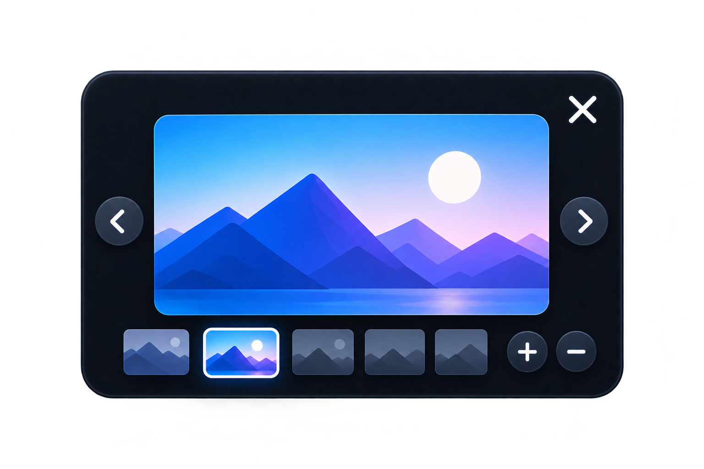
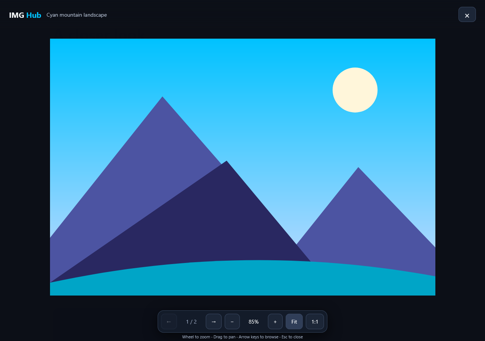
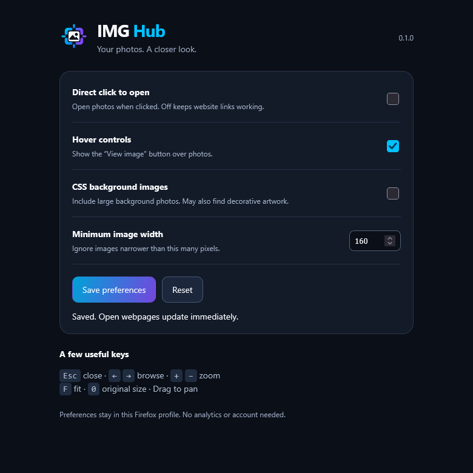

<p align="center"><picture><source media="(prefers-color-scheme: dark)" srcset="assets/wordmark-dark.png"></picture></p>

<p align="center">A closer look at the photos you find on the web.</p>

IMG Hub is a Firefox extension that opens webpage photographs in a dark viewer. Zoom toward your pointer, drag to pan, and browse the page's images without navigating away.

<p align="center"></p>

## Get it into Firefox

1. Download this private repository using **Code → Download ZIP**, then extract it, or clone it:
   ```sh
   git clone https://github.com/Musicpizzaman/img-hub.git
   ```
2. In Firefox **142 or later**, open `about:debugging#/runtime/this-firefox`.
3. Choose **Load Temporary Add-on…** and select `manifest.json` in the extracted project folder.
4. Open or reload a normal webpage with large photos. Hover a photo and choose **View image**.
5. Click the IMG Hub toolbar icon to adjust preferences.

Temporary add-ons are removed when Firefox closes. For permanent installation, have Mozilla sign the extension as **unlisted**, then install its signed XPI. See the [illustrated setup guide](docs/SETUP.md) for the complete process and troubleshooting. Mozilla documents [temporary loading](https://extensionworkshop.com/documentation/develop/temporary-installation-in-firefox/) and [signing](https://extensionworkshop.com/documentation/publish/signing-and-distribution-overview/).

## What works in 0.1.0

- Finds large `` photos, including lazy-loaded and newly inserted images. Filters common icon, logo, avatar, and small-image patterns.
- Shows a compact **View image** button. Direct-click opening is optional and off by default.
- Provides a dark lightbox with previous/next navigation through unique image sources on the current page or frame.
- Supports wheel zoom at the pointer, drag panning, fit-to-screen, original size, and magnification display.
- Closes with **Esc**, the close button, or a click outside the displayed image. Restores the page's scroll position.
- Saves preferences in Firefox locally and applies changes to open webpages. CSS background photos are optional and off by default.

| Key | Action |
| --- | --- |
| `Esc` | Close |
| `←` / `→` | Previous / next image |
| `+` / `−` | Zoom in / out |
| `F` | Fit to screen |
| `0` | Original size |
| Mouse wheel / drag | Zoom at pointer / pan |

## Working extension screenshots

These are captured from the implemented UI in automated Firefox tests, using original local landscape illustrations. The generated artwork above is a concept illustration.





## Build and develop

The extension itself uses plain JavaScript, HTML, and CSS, with no backend or runtime libraries. Node.js 22 or later is needed only for development tooling.

```sh
npm ci
npm test
npm run lint
npx playwright install firefox
npm run test:browser
npm run build
```

The installable source files sit at the repository root. Building creates `dist/img_hub-0.1.0.zip` and a clean `dist/extension/` folder; documentation, tests, references, and development tools are excluded. The ZIP is unsigned.

See [development and architecture](docs/DEVELOPMENT.md), [manual compatibility checks](docs/TESTING.md), [privacy](docs/PRIVACY.md), and [asset provenance and prompts](docs/ASSETS.md).

## Limits and permissions

Firefox blocks extensions on internal pages such as `about:` pages, Mozilla Add-ons, and other restricted domains. IMG Hub targets HTTP and HTTPS pages; local file URLs are outside its scope. Firefox may ask you to grant website access in its extension menu. Reload already-open pages after loading the add-on.

Detection is heuristic: it does not use AI to classify photographs. Galleries are collected when the viewer opens; close and reopen to include later arrivals. Background discovery runs in idle chunks and may need a moment. Each embedded frame has its own viewer and gallery. Images inside website Shadow DOM, canvas artwork, layered CSS backgrounds, and highly customized site widgets are not supported in this version.

Website access lets the content script find images and display the viewer. The storage permission saves preferences. IMG Hub has no analytics, uploads, or account service. Viewing a photo uses its existing source URL and may make an ordinary image request to its website.

## Design

The cyan/violet image-frame identity comes from the supplied boards. Standalone transparent branding and documentation illustrations were recreated using the built-in ImageGen tool; the original boards are retained as [design references](docs/DESIGN.md). Source code is [MIT licensed](LICENSE); supplied reference artwork has no additional license assigned by this project.
