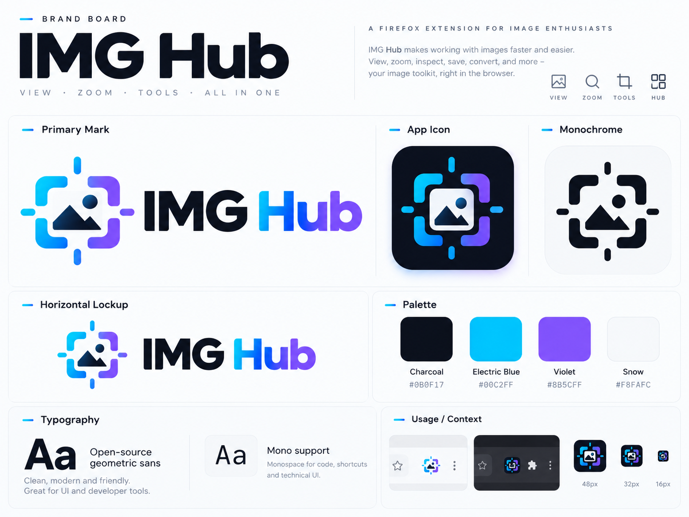
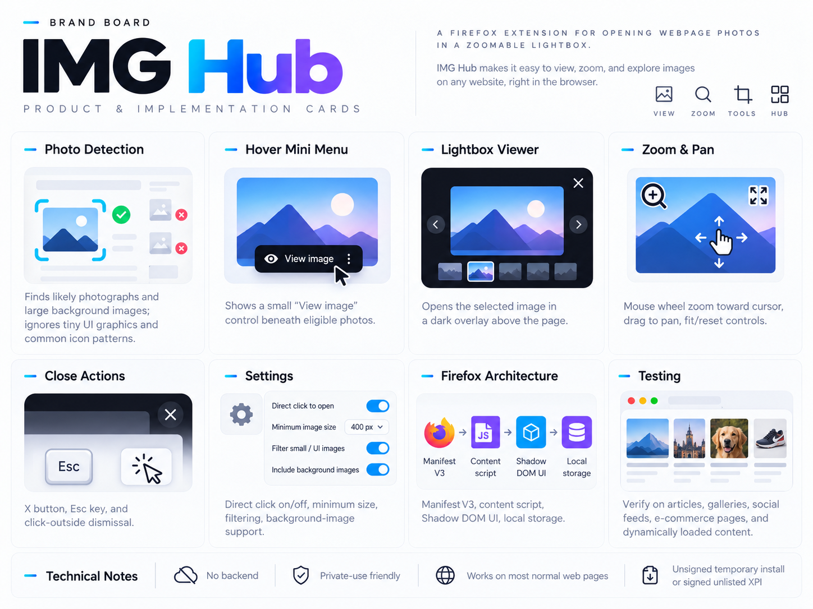
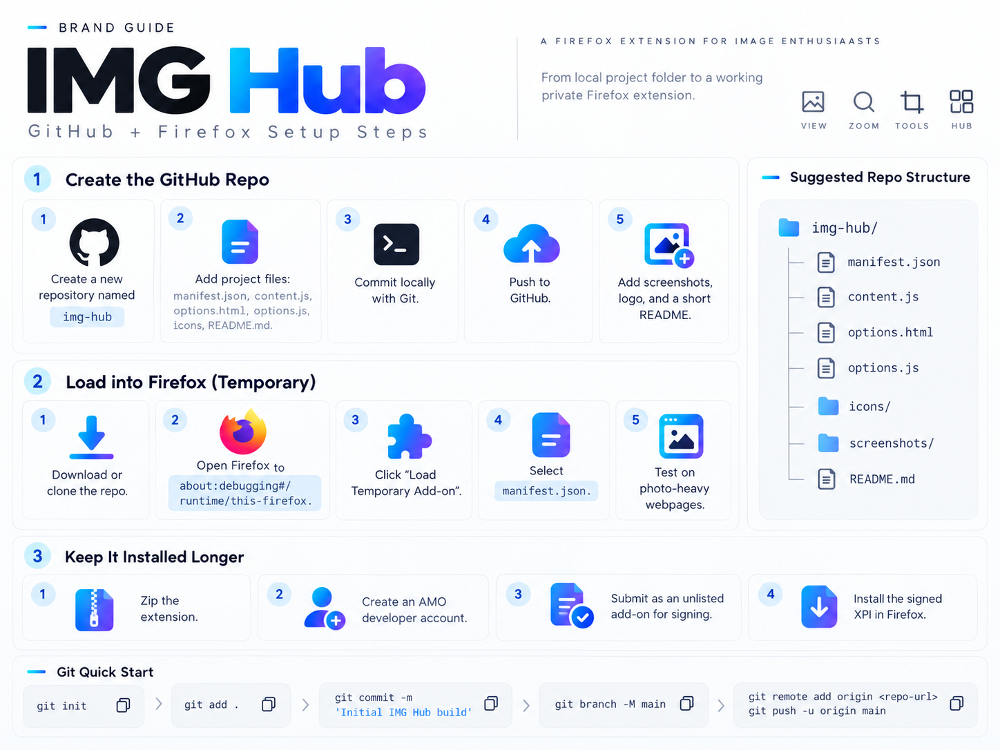
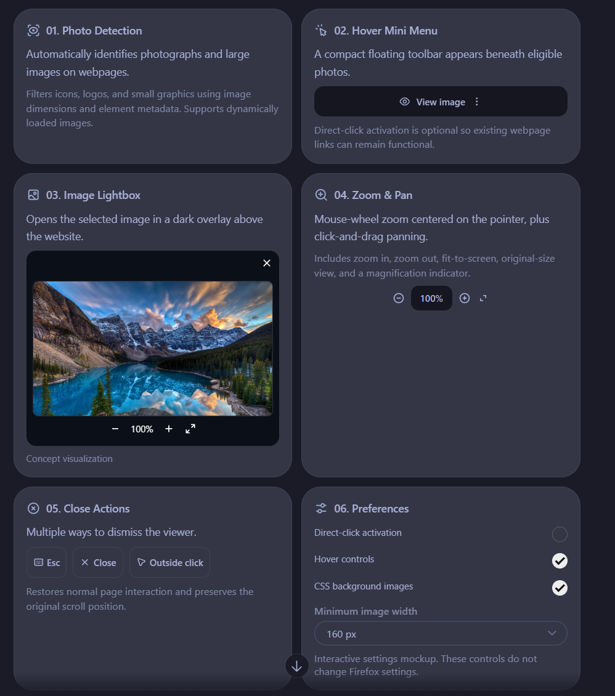
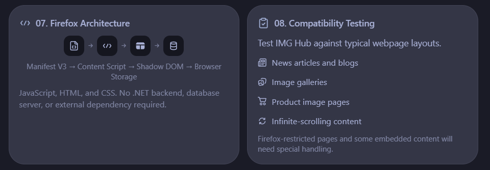

# Design references

The standalone logo, wordmark, viewer concept, and setup artwork used in the README and guide were recreated as transparent PNGs with ImageGen. See [asset provenance](ASSETS.md).

These original supplied boards are retained for context. They are concept references; individual settings, scope, and illustrations may differ from the implemented version.

The written [13 implementation cards](../IMG%20Hub%20Task%20Cards.md) define the feature scope. Version 0.1.0 focuses on viewing, zoom, pan, navigation, and preferences.
